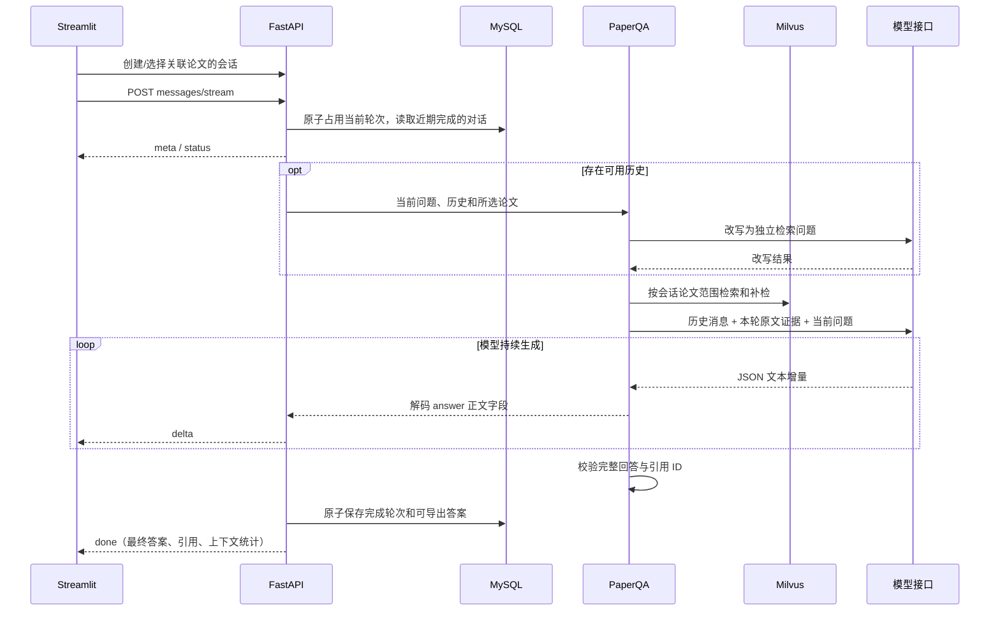

# 连续对话与流式回答

## 使用

本机已有服务的界面是 `http://127.0.0.1:18501`，API 文档是 `http://127.0.0.1:18000/docs`。
全新 Compose 的默认端口仍是 8501、8000，可通过 `.env` 调整。

1. 展开“论文库 · 多篇证据问答”，选择 1–5 篇已完成入库的论文。
2. 在“会话记录”选择“新会话”，或点击“新建会话”，发送第一个问题。
3. 回答正文随模型输出逐步出现；完整结束后显示引用原文、页码和导出入口。
4. 保持论文选择，继续问“它使用哪些数据集？”“它们的方法有什么区别？”等追问。
5. 刷新页面后重新选择相同论文，从会话记录继续。最新会话默认选中；更换论文范围会切换会话。

检索结果中的单篇问答面板复用相同的会话功能。已有检索任务中生成的初始阅读结果仍单独展示，不自动导入新会话历史。
“它”的实际消解由模型完成；无法判明指代时仍应明确写出论文名。此功能没有无限历史记忆。

## 数据与流程



- `conversations`：固定的论文 ID 范围、标题、时间、累计轮次、当前正在生成的轮次。
- `conversation_turns`：按顺序保存问题、实际检索问题、完整答案、上下文统计与生成状态。
- 完成的答案沿用原有单篇/多篇答案表，因此原证据查询和 Markdown 导出接口继续可用。
- 历史由服务端读取；请求只提交当前问题，客户端不能注入任意会话历史。
- 追问会先改写检索问题，再重新检索原文。历史助手消息用于指代理解，引用只从本轮实际提供的证据中构建。

## 上下文控制

| 配置 | 默认值 | 含义 |
| --- | ---: | --- |
| `CHAT_HISTORY_MAX_TURNS` | 6 | 最多携带的近期完整问答对数 |
| `CHAT_HISTORY_MAX_CHARS` | 6000 | 历史消息 JSON 序列化后的字符预算 |
| `CHAT_PROMPT_MAX_CHARS` | 24000 | 整个输入消息序列的序列化字符预算，包含系统指令、历史、问题和证据 |
| `CHAT_MAX_OUTPUT_TOKENS` | 2048 | 本轮最终回答的模型输出 token 上限 |
| `CHAT_LEASE_SECONDS` | 900 | 进程意外退出后，未释放轮次可被下一次提问接管的等待时间 |

历史按完整问答对保留最近的一段；超预算时舍弃更早的对话，不拆成半个问答对。
证据过长时在输入预算内截短，返回引用使用实际提供给模型的文本；如果预算使某篇论文完全失去证据，则返回错误，避免悄悄遗漏比较对象。
这些输入预算按字符计量，**不是模型 tokenizer 的精确 token 数**。改写请求也检查输入预算，输出最多 512 token。

## API 与流式协议

| 接口 | 用途 |
| --- | --- |
| `POST /api/v1/conversations` | 以 `paper_ids` 和可选 `title` 创建会话 |
| `GET /api/v1/conversations?paper_id=A&paper_id=B` | 查找与这组论文对应的近期会话，论文 ID 顺序不影响匹配 |
| `GET /api/v1/conversations/{id}` | 读取最近 50 个轮次；可用 `limit`、`before` 分页 |
| `POST /api/v1/conversations/{id}/messages/stream` | 以 `{"question":"..."}` 提交问题，返回 SSE |

SSE 的 `event` 包括：

- `meta`：会话、轮次和历史预算信息。
- `status`：改写、检索和生成阶段；生成阶段包含实际输入字符数。
- `delta`：已经从模型 JSON 增量中解码的回答正文，正确处理分片转义、换行和 Unicode。
- `done`：完整答案通过校验且数据库提交成功，包含 `answer_id`、引用与上下文统计。
- `error`：本轮失败，不发送 `done`。

单篇和多篇旧 `/questions` 接口仍为独立的一次性问答；当前 MCP 问答工具也仍使用旧接口。

## 失败与中断

同一会话同时只允许一个生成请求，并发请求返回 HTTP 409。不同会话相互独立。
生成中断、输出截断、JSON 校验失败均不会成为成功历史。流式正文在收到 `done` 前属于未完成结果。
断线后会关闭上游流并释放轮次；若上游正阻塞在网络读取，清理需要等待读取返回或超时。
若进程被强制终止而未执行清理，默认 15 分钟后下一次提问可接管，旧轮次标记为 `interrupted`。
过期请求即使随后返回，也无法覆盖新轮次。

## 部署和验收

已有环境先执行新增 Alembic 迁移，然后启动新代码：

```powershell
python -m alembic upgrade head
# 使用 Compose 时，API 启动命令也会执行迁移。
docker compose up --build -d
```

离线回归：

```powershell
python -m pytest -q test_conversation_streaming.py Auto_Paper_UI/test_m4_ui.py Auto_Paper_UI/test_ui_app.py
```

`test_conversation_streaming.py` 还通过真实本机 HTTP 连接验证：完整生成之前客户端已经收到文本，以及客户端断线后轮次得到释放。

本机真实存储验收：

```powershell
docker compose exec api python -m scripts.chat_acceptance
```

该脚本需要两篇不同标题且已入库的论文，使用真实 MySQL、Milvus、Embedding 和 Streamlit AppTest；模型接口替换为本进程内的 HTTP 协议夹具，避免外部模型调用。它检查首次问答、连续追问、历史恢复、页码引用与导出，并清理自己创建的临时会话和答案。
本地结果保存在 `data/m2/chat_acceptance_report.json`，不入 Git。

2026-10-19 已在现有 MySQL 上升级到 `e713ab60d425`，上述存储与界面联调通过：两轮问答、第二轮携带一对历史、真实 Milvus 返回带页码证据，界面恢复与导出通过。
模型调用共为本机协议夹具的两次流式生成和一次问题改写，**外部模型调用为 0**；这些占位回答不用于证明真实模型的指代消解或答案质量。
本轮未运行真实浏览器的视觉检查，界面交互由 Streamlit AppTest 验证。

本次受影响路径回归合计 59 项通过，1 项仅针对 Windows Chroma 路径的测试在 Linux 测试容器中跳过；其中一个旧 M2 模型配置测试已改为访问 LangGraph 包装内的搜索组件。Compose 配置检查通过；GitHub Actions 是否通过仍以推送后的云端结果为准。

本机 API/UI 已同步当前源码并重启，API 版本为 `4.1.0`，数据库和界面健康检查通过。本轮没有重新构建容器镜像；重建容器时应使用当前源码执行 `--build`。当前工作区没有 `.env`，本轮沿用现有容器中的配置，没有重写凭据；完整重建 Compose 前需恢复原有数据库密码和模型配置。
