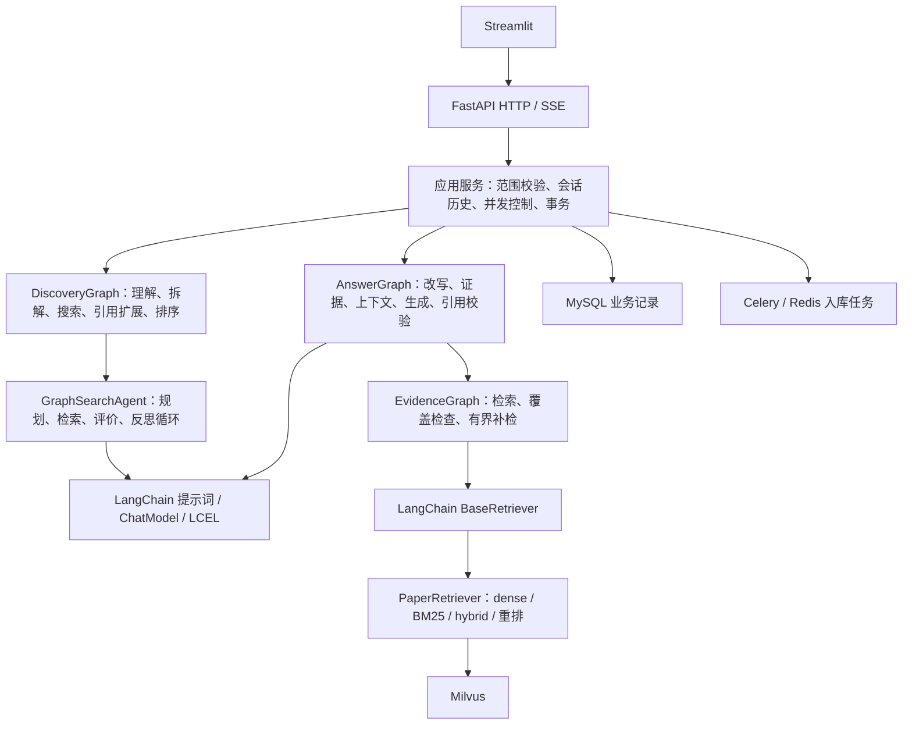

# LangChain / LangGraph 架构重构

本次升级将核心 AI 流程统一为 LangChain 组件接口与 LangGraph 工作流。
FastAPI、MySQL、Celery 和 Streamlit 继续负责应用服务、事务、后台入库和交互。
没有修改已有数据表、向量集合或嵌入模型配置；无需迁移数据或重建索引。

## 实际结构



`DiscoveryGraph` 包含核心论文发现阶段；选文、下载与入库仍由应用服务和后台任务管理。
它内部调用已有 `GraphSearchAgent`，保留最大轮数、时间限制、规则回退与 SQLite 检查点。
父图不额外持久化或自动重放外部操作。

`AnswerGraph` 是单轮 API、跨论文 API 和多轮 SSE 问答共用的执行流程：

1. 有历史且未指定独立检索问题时，在图内执行问题改写。
2. 通过证据子图调用标准 Retriever，必要时有限补检。
3. 没有证据或某篇所选论文完全没有证据时，直接返回无法回答，跳过模型。
4. 统一控制整个序列化提示词的字符预算，保留论文范围。
5. 使用 LCEL 调用模型；流式分支即时解析 JSON 中的回答正文。
6. 完成后验证答案结构和本轮引用 ID，重建可定位的引用。
7. 应用服务收到有效答案后提交 MySQL，再发送 `done`。

覆盖检查仍是“每篇至少两个片段”等确定性规则，不是语义充分性判断。
引用校验保证引用来自本轮证据，不等于自动证明回答中每个事实正确。

## 组件接口与实现文件

| 文件 | 职责 |
| --- | --- |
| `ai_components/models.py` | `ProviderChatModel(BaseChatModel)`；标准消息、invoke/batch/stream、回调与 usage；支持直接注入原生 LangChain ChatModel |
| `ai_components/chains.py` | `ChatPromptTemplate → ChatModel → StrOutputParser` 的共享 LCEL 链 |
| `rag_reader/langchain_retriever.py` | `ScopedPaperRetriever(BaseRetriever)`；固定论文范围；Document 与 DocumentChunk 无损转换 |
| `rag_reader/embedding.py` | `EmbeddingModel(Embeddings)`；embed_query / embed_documents，共用原有 BGE-M3 向量实现 |
| `rag_reader/answer_graph.py` | 完整问答图、原生 LangGraph custom 流事件、取消信号 |
| `rag_reader/answer_contracts.py` | 提示词预算、JSON 解析、引用校验等领域规则 |
| `rag_reader/qa.py` | 保留 ask / ask_many / stream 兼容入口；把执行交给问答图 |
| `app/workflows/discovery.py` | 论文发现图，包含可选引文扩展分支 |
| `app/workflows/contracts.py` | 搜索工作流数据转换与阶段报告，避免图反向依赖应用服务 |
| `app/services/conversations.py` | 历史读取、会话并发租约、成功提交、失败与断连记录 |

模型生成链覆盖问答、追问改写、摘要、知识抽取、查询理解、查询拆解、搜索规划/评价/反思和论文评分。
现有各模块的 Provider 客户端保留为 HTTP 传输兼容层，底层仍使用 OpenAI 兼容 SDK。
没有引入第二套默认重试，也没有宣称已经实现模型工具调用、图像输入或原生 function calling。
需要这些能力时应另行接入并验证对应 ChatModel。

Retriever 适配器保留 paper_id、chunk_id、page、section、title、retrieval_score 和原有 metadata。
混合检索、RRF 和重排仍由原有实现执行；并未换成 LangChain 默认检索算法。
如果后端返回范围外的论文证据，会抛出错误，阻止引用串入其他论文。

## 流式、持久化与失败边界

- LangGraph `custom` 事件传递状态与增量正文，最终节点更新返回已校验答案；不是完整生成后模拟打字。
- SSE 事件仍为 meta/status/delta/done/error；`retrieving` 状态附带实际检索问题。
- 断开后先发出取消信号，再关闭图与上游流；等待中的同步供应商请求受其超时限制，不能承诺瞬间中断阻塞的网络读取。
- 已输出的回答不会自动重试或重放；失败和取消轮次不进入有效历史。
- 对话历史仍存 MySQL；问答图没有持久化 checkpoint，不会从半段流式答案继续生成。
- 搜索图保留 SQLite checkpoint；存在 checkpoint 不代表已实现跨进程自动恢复所有业务步骤。
- 预算仍按序列化消息字符计数，不是精确 token 计数。本次单轮问答也开始使用同一默认 24000 字符预算；极长输入可能被裁剪或明确拒绝。
- 原有 Langfuse 手工 span 保留。LangChain callbacks 已可传递和测试，没有默认开启新的外部追踪服务。

## 验收方式

新增 `test_langchain_architecture.py` 检查真实组件替换、模型与 Retriever 回调、消息顺序、参数与 usage、
流式关闭、引用元数据往返、论文范围隔离、问答图公共路径、无证据分支、无效答案、
发现图可选分支、日期过滤、任务取消及嵌入接口一致性。

配合现有会话/API/UI/检索/搜索/评测回归，以及本机集成脚本：

```powershell
python -m pytest -q test_langchain_architecture.py test_conversation_streaming.py test_m5_workflow.py test_m1_service.py
python -m scripts.chat_acceptance
```

后者要求已配置的本机 MySQL、Milvus 和本地 BGE-M3；使用 loopback 模型协议夹具，
不发送论文给外部模型，临时验收会话在结束时清理。
它验证两轮问答、真实检索、持久化、HTTP 流式和 Streamlit 交互，不衡量真实模型的回答质量。

## 运行与依赖

本次使用已有 langchain-core / langchain-text-splitters / langgraph 依赖，未增加大型服务。
开发中的兼容传输层无需额外安装 `langchain-openai`；已通过测试的本机版本是 langchain-core 1.6.12、langgraph 1.2.16。
仓库继续使用既有依赖范围，未声称已经逐一验证所有范围内版本。

有完整本地 `.env` 时，正式重建按已有方式执行 `docker compose up --build -d`。
保留原有 MySQL 密码、模型目录、集合与端口配置；示例文件只用于说明配置。
代码部署记录和最终测试结果见[本次验收记录](LANGCHAIN_REFACTOR_ACCEPTANCE.md)。
