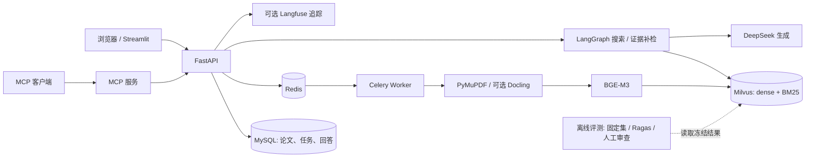

# M6 评测与交付：复现、演示及验收

## 系统结构



MySQL 保存业务状态；Milvus 索引可以从论文重新构建。Celery 负责耗时入库，LangGraph 只处理需要分支和循环的搜索与证据补检。Ragas 在独立的可选评测环境运行，不参与在线问答。

## 新环境启动与界面演示

1. 安装 Docker Desktop 并确保 Docker Engine 可用；复制 `.env.example` 为 `.env`，修改其中的 MySQL 密码。本机如端口冲突，设置 `SCHOLARTRACE_API_PORT`、`SCHOLARTRACE_UI_PORT`、`SCHOLARTRACE_MCP_PORT`。
2. 在项目根目录运行 `docker compose --env-file .env config --quiet`，再运行 `docker compose --env-file .env up --build -d`。首次构建需要下载 CPU PyTorch 等依赖，首次入库需准备 BGE-M3 模型。用 `docker compose --env-file .env ps` 检查 MySQL、Milvus 及依赖、Redis、API、MCP、worker、beat、UI 共 10 个服务。
3. 打开 `http://127.0.0.1:8501`，先选择已有论文或搜索候选论文、勾选需要的论文、提交入库、观察进度；两篇 READY 后进入多论文问答，检查答案旁的 PDF 页与原文，最后导出 Markdown。无密钥时可查看已入库资料及运行离线评测；实时搜索与生成需要配置对应密钥。
4. API 契约在 `http://127.0.0.1:8000/docs`；MCP 地址是 `http://127.0.0.1:8001/mcp`。端口有自定义配置时按 `.env` 调整。

无外部搜索密钥的界面演示可以用 `scripts/m4_acceptance_seed.py` 把**已有本地 PDF** 注册为候选，然后走真实入库流程。该脚本只创建 MySQL 中的候选任务，不伪造已入库状态；需要先运行 Alembic 迁移，并把 PDF 挂到 API 容器可访问的路径。示例命令如下，路径和标题按本机 PDF 修改：

```powershell
docker compose exec api python -m scripts.m4_acceptance_seed --paper "demo-paper|Example Paper|/app/data/m2/papers/example.pdf"
```

种子脚本打印的 `discovery_job_id` 可在 UI 读取并继续选文。这个示例不会调用模型。若使用 `.env` 中非默认端口或凭据，`docker compose exec` 也需使用相同 `--env-file`。公开论文 PDF 和 BGE 模型较大、授权各异，不放入 Git 仓库；初次演示需自行准备。

## 固定评测复现

无密钥回归：

```powershell
python -m pytest -q test_m6_evaluation.py test_m5_workflow.py test_m4_async.py test_m3_retrieval.py test_m3_api.py test_m2_api.py test_m1_rag.py test_m1_service.py
```

CI 使用 GitHub Actions 执行同一组回归、Ragas 小样本和 Compose 配置校验，不需要私有密钥或论文 PDF。大规模模型/数据集评测留在本机，避免 CI 自动下载数 GB 资料。

QASPER test-30：先按 [数据集说明](DATASETS.md)下载 QASPER，准备本地 BGE-M3 和 BGE reranker，再在项目镜像中执行：

```powershell
docker run --rm --network auto_paper-model_default -v "${PWD}:/app" -w /app -e HF_HUB_OFFLINE=1 auto_paper-model-api:latest python -m evaluation.run_m3_ablation --split test --limit 30 --seed 42 --top-k 5 --candidate-k 20 --milvus-uri http://milvus:19530 --collection m6_qasper_test30_20261018 --embedding-model /app/data/m3/bge_m3_model --reranker-model /app/data/m3/reranker_hf_cache/hub/models--BAAI--bge-reranker-v2-m3/snapshots/953dc6f6f85a1b2dbfca4c34a2796e7dde08d41e --run-dir evaluation/runs/m6_qasper_test30_20261018
```

四道跨论文题读取 M3 的十篇 PDF 索引，不生成新回答：

```powershell
docker run --rm -v "${PWD}:/app" -w /app -e HF_HUB_OFFLINE=1 auto_paper-model-api:latest python -m evaluation.run_m6_multi_evidence --run-dir evaluation/runs/m6_multi_evidence_v2_20261018
```

缓存答案的离线 Ragas 复核使用 `evaluation/requirements-ragas.txt`，建议在独立虚拟环境或临时容器安装。Ragas 0.4.3 与较新的 `langchain-community` 导入路径冲突，因此此处固定兼容版本；运行 `python -m evaluation.run_m6_ragas` 后只得到字串存在率，**不是** faithfulness。人工审查执行 `python -m evaluation.m6_review`，在本地生成的 CSV 逐行填写 `answer_correct`、`citations_supported`（`yes/no`）、错误类型、复核人，再执行 `python -m evaluation.m6_review --summary-only`。留空项不能计为正确。

也可用本地页面复核，无需直接编辑 CSV。它逐题展示缓存回答、引用和原始 PDF 页，点击保存后写回同一张表。先生成复核表，再运行：

```powershell
docker run --rm -p 127.0.0.1:18506:8501 -v "${PWD}:/app" -w /app auto_paper-model-api:latest python -m streamlit run evaluation/m6_review_ui.py --server.address=0.0.0.0 --server.port=8501
```

浏览器打开 `http://127.0.0.1:18506`。该页面逐条显示引用及其 PDF 页，并允许查看其他页；每题分别判断回答事实和引用支持，填写复核人、错误类型与必要的备注，点击“保存本题”。默认只显示未完成题，保存后自动切到下一题；取消该筛选可以修改已保存的判断。该页面不调用模型或外部接口；文件和审查结果都留在本机。审查人应以原始 PDF 为准，标注候选和自动风险提示只用于定位，不能直接当作正确性结论。

`python -m evaluation.render_m6_gold_pages --split test` 可将金标准页渲染为本地 PNG，辅助核对表格值和页码。要报告全部 44 条的人工正确率，必须逐条核对回答与引用；也可先完整复核 test 的 10 道问题 × 2 种解析路径，仅报告这 20 条的分组结果，不能把它说成 20 道独立题或全量结果。页面会优先展示自动风险提示；[AI 初审](M6_AI_ASSISTED_REVIEW.md)另列六条重点核对记录，两者都只是线索。全部结果位于被 `.gitignore` 排除的 `evaluation/runs/`。填写后运行 `python -m evaluation.report_m6`，从固定运行记录重建 `docs/M6_REPORT.md`。新留出题的结果与默认策略决定见 [检索优化后续记录](M6_RETRIEVAL_FOLLOWUP.md)。

AI 初审的逐项判断单独存放，不会写入具名人工复核表；初审比例不能称作人工正确率。

## 本轮验收范围

- 已以固定 seed 跑 QASPER 留出集六路检索消融，保留逐题耗时和失败记录；报告中的数值按同一 test 集比较。
- 已以四道跨论文题对照普通 Top-5 与证据补检图，分别统计论文覆盖、页码和答案片段、附加片段成本；测试集金标准页已经视觉抽查，完整独立人工复核仍待完成。
- 已对 M3 缓存的 44 条回答执行 Ragas 离线 StringPresence，创建 44 行人工审查表；未调用新的 DeepSeek 或在线判分模型。
- 已验证 M6 回归、Compose 配置，以及本机已有的十服务运行状态。GitHub Actions 云端执行结果以推送后的 Actions 页面为准。

## 面试演示顺序

1. 用 UI 展示候选选文、入库进度、两篇论文的带页码回答和导出。
2. 打开 API 文档和 MCP 的五个工具，说明三类入口共用业务逻辑。
3. 指向上图解释 MySQL、Milvus、Redis/Celery、LangGraph 的边界，以及失败后状态如何保留。
4. 打开 [M6 评测报告](M6_REPORT.md)，对同一 test 集解释基线、收益、CPU 延迟和失败案例；明确 gold 标注与人工审查边界。
